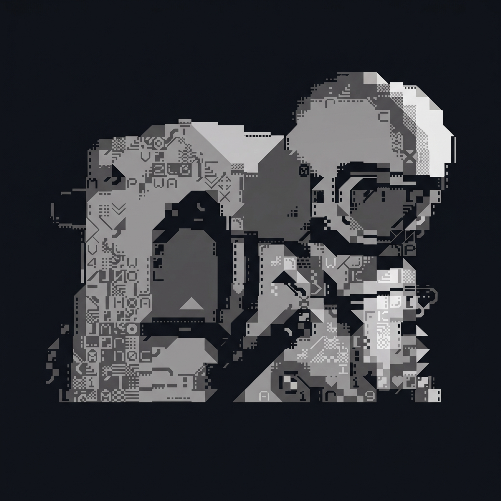

<h1 align="center">Quantum Computing</h1>

<p align="center">
  
</p>

 
<p align="center">
  <em>From zero to full-stack quantum programming: a structured, hands-on path through Qiskit, PennyLane and Qibo.</em>
</p>

<p align="center">
  
  
  
  
  
</p>

---

## About

This repository documents my learning process in quantum computing, starting from the mathematical foundations and progressing to implementing quantum algorithms and variational quantum machine learning models on real and simulated hardware.

The goal is simple: move from **zero to full**, with code that is clear, reproducible and reviewed like production work.

## Learning Path

| Phase | Focus | Frameworks | Status |
|:-----:|-------|-----------|:------:|
| 1 | Linear algebra, qubits, gates, measurement | NumPy | 🟡 In progress |
| 2 | Circuits, transpilation, simulation, noise | Qiskit | ⬜ Planned |
| 3 | Variational circuits, gradients, QML models | PennyLane | ⬜ Planned |
| 4 | High-performance simulation and hardware backends | Qibo | ⬜ Planned |
| 5 | Applied projects: algorithms and research replication | All | ⬜ Planned |

## Repository Structure

```
Quantum-Computing-/
├── 01-foundations/     # Linear algebra and single/multi-qubit systems
├── 02-qiskit/          # Circuits, algorithms (Grover, QFT, VQE) and noise models
├── 03-pennylane/       # Variational circuits and quantum machine learning
├── 04-qibo/            # Simulation backends and benchmarks
├── 05-projects/        # Applied and research-oriented projects
└── assets/             # Figures and banners
```

## Getting Started

```bash
git clone https://github.com/CuervoBlanco05/Quantum-Computing-.git
cd Quantum-Computing-
python -m venv .venv
source .venv/bin/activate        # Windows: .venv\Scripts\activate
pip install qiskit pennylane qibo numpy matplotlib
```

## Principles

- **Math first:** every algorithm is derived before it is coded.
- **Reproducibility:** fixed seeds, pinned dependencies and documented results.
- **Cross-framework comparison:** the same problem is solved in Qiskit, PennyLane and Qibo to understand their trade-offs.
- **Clean code:** typed Python, tests where they add value, and clear notebooks.

## Resources

- Nielsen & Chuang, *Quantum Computation and Quantum Information*
- [Qiskit Textbook](https://github.com/Qiskit/textbook)
- [PennyLane Documentation](https://docs.pennylane.ai)
- [Qibo Documentation](https://qibo.science)

## Author

**Cuervo Blanco** · Physics M.Sc. student (UAS) · Quantum Machine Learning researcher

## License

This project is licensed under the MIT License. See [LICENSE](LICENSE) for details.
